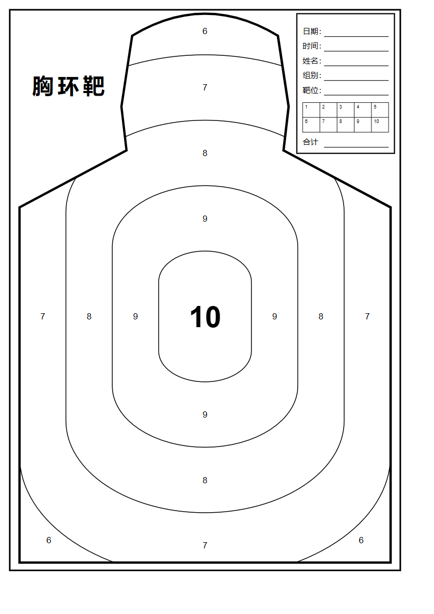

# A4 靶纸生成器

生成打印用的 A4 胸环靶，自己练弹弓打的靶纸。改一个数字就能换挡数。

[English](README.en.md)



## 跑起来

主脚本是 `generate_target.py`，跑完在当前目录得到 `target_A4.svg`。

```bash
python generate_target.py
```

要 PDF 和预览图再跑 `export_pdf.py`，它读刚才那个 SVG：

```bash
python export_pdf.py
```

PDF 页面就是 210×297mm。打印时缩放选「实际大小」或 100%，别用「适合页面」，否则出来要小一圈。

依赖只有 playwright：

```bash
pip install playwright
```

没装过 Chromium 也能跑，脚本会依次退回本机的 Edge、Chrome。

## 换挡数

`generate_target.py` 顶部是参数区，第一行 `N_RINGS` 是挡数总开关。靶面宽度固定撑满 A4（190mm），环带宽度按 `95/(N_RINGS-1)` 自动算，所以改这一个数，环线位置和所有分值都跟着走。

| N_RINGS | 环带宽 | 分值 |
|---|---|---|
| 3 | 47.5mm | 10~8 |
| 4 | 31.7mm | 10~7 |
| 5 | 23.8mm | 10~6 |
| 6 | 19.0mm | 10~5 |
| 8 | 13.6mm | 10~3 |
| 10 | 10.6mm | 10~1 |

脚本跑完会直接把这张表打印出来，挑挡数时不用翻文档。仓库里这张图是按 5 挡出的。

挡数越少环带越宽，判环越容易。A4 就这么大，挡数和环带宽只能二选一。

## 靶面怎么画的

环制照标准胸环靶。环线是等距放大的操场形（左右两条竖直直边 + 上下圆头），不是椭圆。最外那条环线的直边正好贴住靶面两侧竖边，再往外没地方画，所以最大的一档只在头顶和底部两角成带，标准靶就是这么排的。

两个形状比例是从参考靶上量出来的，写在参数区：圆头半高/半宽 `CAP_R = 0.66`，直边长/半宽 `SIDE_K = 1.50`。想调圆头肥瘦、直边长短就改这两个数。

头型和肩角也是照参考靶量的：头顶是一条很宽的浅弧，一直张到半宽 37.3mm 才接直边；头两侧先外扩到 42.8mm 最宽，再往里收到 40.2mm 的底角；肩线与水平线夹 28°。对应参数是 `HEAD_*` 那一组和 `SHOULDER_DEG`。肩角一改，靶面竖边的起点跟着动，右上那个框的底边就会顶到肩线，`BOX` 得一起看。

右上角是信息加记分合并的一个框，5 行填空加 2×5 的记分格。字段名在参数区的 `BOX_FIELDS`；框本身的位置大小是 `BOX`，往下加字段会顶到肩线。

## 文件

| 文件 | 说明 |
|---|---|
| `generate_target.py` | 出 SVG，参数都在这一个文件顶部的参数区 |
| `export_pdf.py` | SVG → PDF + `preview.png` |
| `target_A4.svg` | 矢量成品，放大打印不失真 |
| `target_A4.pdf` | 打印用 |
| `preview.png` | 上面那张预览图 |

## 字体

SVG 里中文写的是 `Microsoft YaHei, SimHei, sans-serif`，数字是 `Arial, Helvetica`。Windows 上直接可用；Linux 和 macOS 会走系统兜底字体，标题「胸环靶」的字形可能不一样。

## 许可

MIT，见 `LICENSE`。
